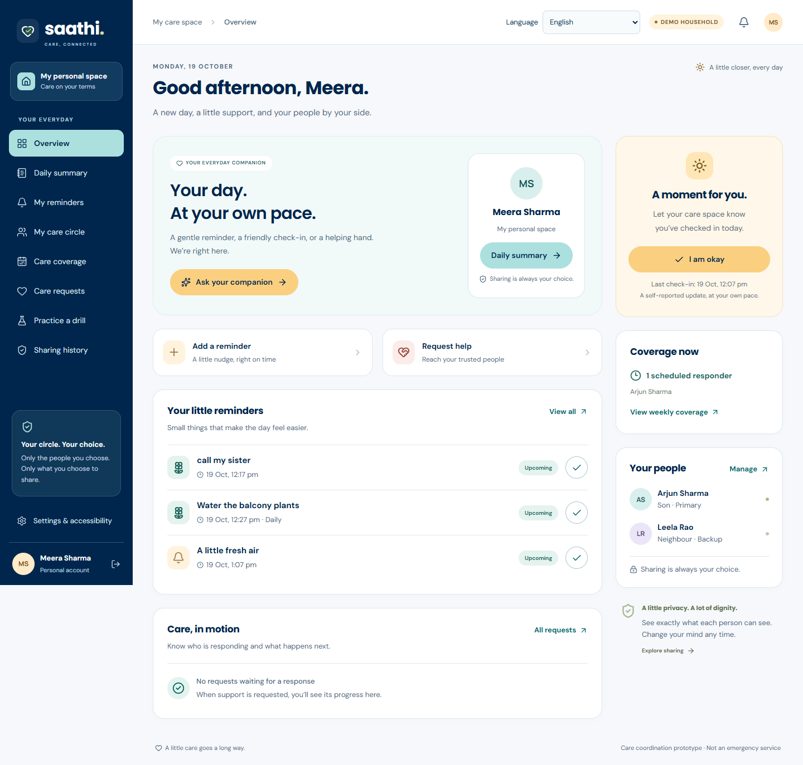
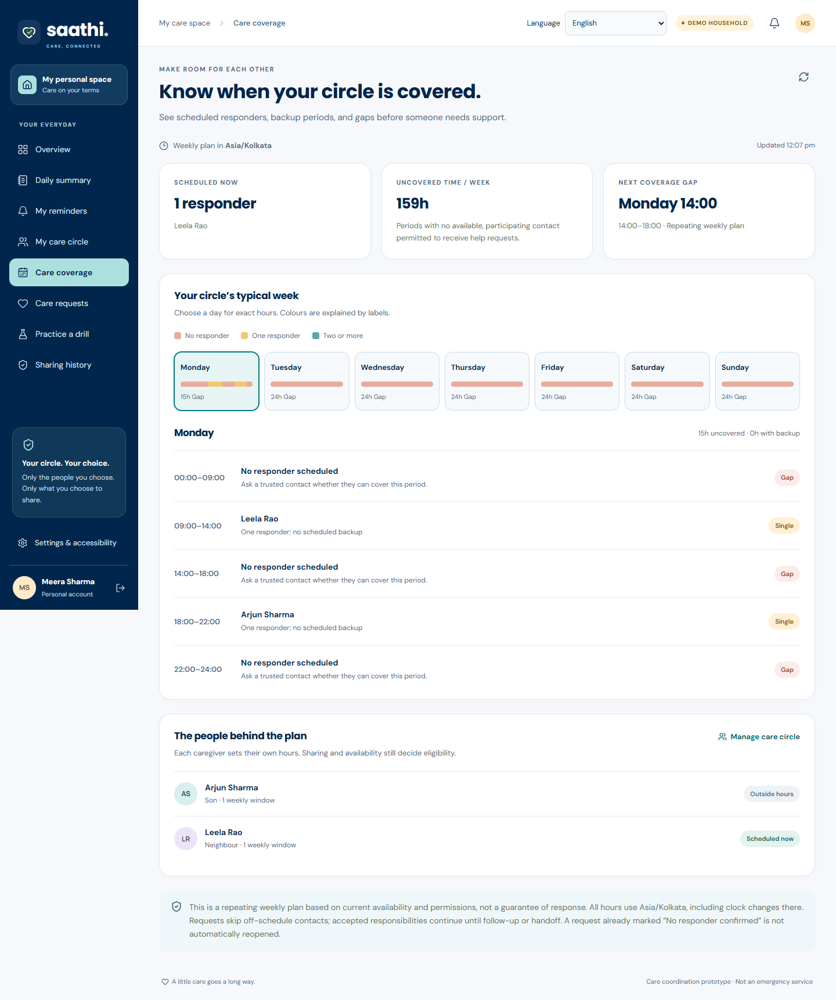

# Saathi Care AI

**A little closer, every day.** A working elder-care coordination prototype with confirmed reminders, per-contact privacy, persistent caregiver handoffs, and repeatable drills.



The interface uses a Birdie-inspired navy, aqua and amber visual system across the older-adult and caregiver views, with responsive cards, regional-language layouts and keyboard-accessible mobile navigation. See the [visual comparison and redesign QA](design-qa.md).

## Run locally

Requires **Node.js 24.x** and npm. SQLite is included with Node; no separate database installation is needed.

```sh
npm ci
npm run dev
```

Open **http://localhost:5173**. The API runs on port 3001. Choose **Continue as Meera**, **Arjun**, or **Leela** to explore the fictional household. Use separate browser profiles or private windows to demonstrate two roles simultaneously; ordinary tabs share the same sign-in cookie.

For a built application served from one process:

```sh
npm run build
npm start
```

Open **http://localhost:3001**. Data persists in `data/saathi.sqlite` across restarts. Keep the server running for reminder and escalation timers. No secrets or real-user database files are checked into Git.

## What is implemented

| Feature            | Behavior                                                                                                                                                  |
| ------------------ | --------------------------------------------------------------------------------------------------------------------------------------------------------- |
| Separate accounts  | Password authentication, HTTP-only sessions, isolated households, one-time email-bound invitation codes                                                   |
| Personal dashboard | Manual check-in, reminder inbox, help requests, care-circle summary                                                                                       |
| Daily summary      | Today's permitted check-in, reminder progress, real request status and remaining response coverage; explicit check-in sharing defaults off                |
| Display languages  | Saved account-specific language choice, 14 draft regional interfaces plus English, local translation files and Urdu RTL layout                            |
| Reminders          | Fixed-time or check-in-relative reminders; daily check-in recurrence; completion, snooze, cancellation, deduplication                                     |
| Language requests  | Review a proposed reminder or sharing change before confirming; limited English local interpreter works without a key; regional manual entry is available |
| Optional live AI   | OpenAI-compatible chat-completions adapter with validation, timeout, request limits, and labelled fallback                                                |
| Speech             | Optional English browser speech input and read-back; text entry is always available                                                                       |
| Consent            | Per-contact request, private-note, and reminder permissions; server-filtered preview; revocation on subsequent reads/actions                              |
| Care response      | Primary/backup ordering, accept/decline, timeout, named ownership, overdue follow-up, explicit outcome, cancellation                                      |
| Care coverage      | Caregiver-owned weekly hours, exact gap and backup periods, household timezone, and schedule-aware invitation routing                                     |
| Persistence        | SQLite transactions, durable deadlines, indexed due work, event deduplication, audit and incident timelines                                               |
| Drills             | Synthetic events, accelerated timers, explicit contact opt-in, JSON report export, no external drill messages                                             |
| Notifications      | Live in-app caregiver inbox; optional opt-in webhook with bounded retries and separate provider status                                                    |
| Accessibility      | Responsive layouts, labelled controls, native focus-trapping dialogs, keyboard focus, reduced motion, larger-text setting                                 |

The implementation uses the simpler persistent-backend option in the blueprint: **React + TypeScript + Vite**, **Express**, **Node SQLite**, and a server-side worker. It does not require AWS infrastructure.

Choose a display language before registration or from the signed-in header. Personal notes remain as written. Eight scheduled languages are still marked **Not yet**; regional translations need fluent-speaker review. See [language availability, privacy, and limitations](docs/LOCALIZATION.md).

Open **Daily summary** for the live daily view. To share check-ins, the older adult must enable **My care circle → Edit permissions → Check-in sharing** for each person. See [daily summary behavior and privacy](docs/DAILY_SUMMARY.md).

## Try the main story

1. Enter as **Meera**. Select **Ask your companion**, then type: `Remind me to water the plants 20 minutes after my morning check-in`.
2. Review and confirm. Press **I am okay** to schedule the event-linked reminder.
3. Open **My care circle**. Preview Leela's view: private notes and reminders are hidden.
4. Open **Leela** in a separate browser profile and navigate to **Care requests**.
5. As Meera, start **Practice a drill**. If Arjun does not accept within 10 seconds, Leela is invited.
6. As Leela, open the request and select **I will respond**. Record an outcome and resolve it.
7. As Meera, inspect the timeline and sharing history, or export the drill report.

Acceptance and resolution are different. An unanswered request remains visibly unresolved. Permissions are enforced by the API, not just hidden in the interface.

## Plan weekly care coverage

1. Sign in as a caregiver (Arjun or Leela in the demo), open **My weekly hours**, and choose **Edit my weekly hours**.
2. Select **Only during my weekly hours**. Add one or more windows to each day you can respond, then save. **All day** adds a full-day window. An end time of `00:00` means midnight at the end of that day; split overnight hours across two days.
3. As the older adult, open **Care coverage**. Select a day to see exact gaps, single-responder periods, and periods with a backup. The dashboard also shows who is currently scheduled.
4. Requests skip people outside their scheduled hours. An unanswered invitation hands off if its recipient goes off schedule. Accepted responsibilities continue beyond the scheduled period until outcome or handoff.

Schedules repeat weekly in the **household's timezone**, which is displayed in both the planner and editor. Caregivers set only their own hours and see only their own schedule; the older adult sees the combined plan. The availability switch, participation, and request-sharing permission still apply, so pausing participation removes that contact from the displayed coverage. Overlaps are merged; simultaneous edits cannot silently overwrite a newer save.

Existing contacts retain **Any time I am marked available** until they explicitly set weekly hours. A weekly schedule with no windows means no new invitations. The plan describes scheduled availability, not guaranteed assistance; it does not automatically reopen requests that already exhausted their responders. Gaps are shown in the planner rather than sent as external alerts.



## Your own household

Choose **Create your care circle** instead of a demo profile. Register an older-adult account, then invite a contact from **My care circle**. Share the generated code privately; the app does **not** email it. The contact registers with the specified email and code. New contacts must opt in to drills in their availability settings.

The prototype links newly registered contacts to one household. Existing-account linking, multi-household caregiving, email verification, and account recovery are not implemented.

## Optional integrations

Copy `.env.example` to `.env` and restart the server after editing it.

```dotenv
AI_API_KEY=your-provider-key
AI_BASE_URL=https://api.openai.com/v1
AI_MODEL=your-available-model
```

All three values should match an available OpenAI-compatible chat-completions model supporting JSON-object output. Without credentials, the UI clearly identifies the **local language helper**. Live responses are validated, never execute tools directly, and fall back locally on invalid output or provider failure. Text requests and contact names are sent to the configured AI provider; credentials remain on the server. Actual provider access and billing must be configured by the repository owner.

For an optional webhook, set `NOTIFICATION_WEBHOOK_URL` and optionally `NOTIFICATION_WEBHOOK_TOKEN`. A caregiver must enable external notifications in their settings. Payloads contain generic text and identifiers, not private care notes. Drill events never use this channel. See [architecture and API documentation](docs/ARCHITECTURE.md).

Browser speech availability and languages depend on the browser/provider. Microphone use starts only on an explicit click and may send audio to the browser's speech service. The application does not store audio. Real microphone recognition and a live paid AI/notification provider were not exercised during automated verification.

## Verify

```sh
npm run check
npm run test:e2e
```

`check` runs TypeScript, the production build, and backend tests. Browser tests start their own server on port 4011 and use a separate temporary database under `.runtime`; they never use your household database. On Windows, tests use installed Google Chrome. Elsewhere, install the Playwright browser first:

```sh
npx playwright install chromium
```

Set `PLAYWRIGHT_CHANNEL` to override the browser channel if needed. See [verification notes](docs/VERIFICATION.md) for coverage and limitations. The GitHub Actions workflow runs build, backend, and browser checks on pushes and pull requests.

## Reset fictional data

Stop the running app, then run:

```sh
npm run demo:reset -- --confirm
```

Only the seeded `demo-home` household and accounts joined to it are reset. Other households are preserved. Demo password sign-in, if needed: `meera@saathi.demo`, `arjun@saathi.demo`, or `leela@saathi.demo` with `SaathiDemo2026!`. These are intentionally public fictional accounts. Do not enter real personal information into them.

## Docker and hosting

```sh
docker compose up --build
```

The supplied Compose configuration is for a **local demo**, bound to loopback with a persistent volume. It enables fictional accounts and HTTP cookies for localhost. For an internet deployment, use HTTPS, `COOKIE_SECURE=true`, `DEMO_MODE=false` unless publishing a deliberately synthetic demo, a persistent local disk, restricted database access, and a single app instance. Set `HOST=0.0.0.0` behind your proxy. Do not deploy this SQLite/worker design as ephemeral serverless functions or multiple independent instances.

Docker files are provided; Docker execution was not available in the implementation environment. No public application deployment has been made.

## Documentation

- [Architecture, state machine, and API](docs/ARCHITECTURE.md)
- [Verification and known limitations](docs/VERIFICATION.md)
- [Demo and submission guide](docs/DEMO.md)
- [Original 24-page project blueprint](deliverables/Saathi_Care_AI_Hackathon_Project_Blueprint.pdf)
- [Blueprint HTML](deliverables/Saathi_Care_AI_Hackathon_Project_Blueprint.html)

The blueprint remains the original planning document; the README and verification notes describe the implemented scope. Its Python PDF generator can be run separately with `pip install -r requirements.txt` and `python deliverables/build_report.py`; it uses Windows Calibri fonts.

## Attribution and scope

Inspired by the **Suraksha** elder-care case study by **Team StarBugs**: [developer article](https://builder.aws.com/content/3K6LxdJtlqL9aB4rmjHJB0aMses/the-first-commit-of-our-hackathon-game-or-wemakedevs-aws-winners-of-ship-it-track), [official original winners](https://www.wemakedevs.org/aws/first-commit/projects). This is a separate implementation for [Next Byte Hacks V5](https://next-byte-hacks-v5.devpost.com/), not the original Suraksha application or a claim to its prizes.

This is a hackathon care-coordination prototype. It does not diagnose, validate wellbeing, detect falls, verify medication use, call emergency services, or guarantee notification delivery. Real clinical validation, supported wearable integration, and supervised field evaluation remain future work. No real-user or clinical outcome claims are made.
