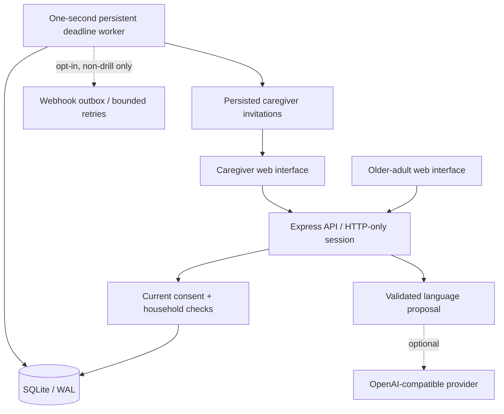
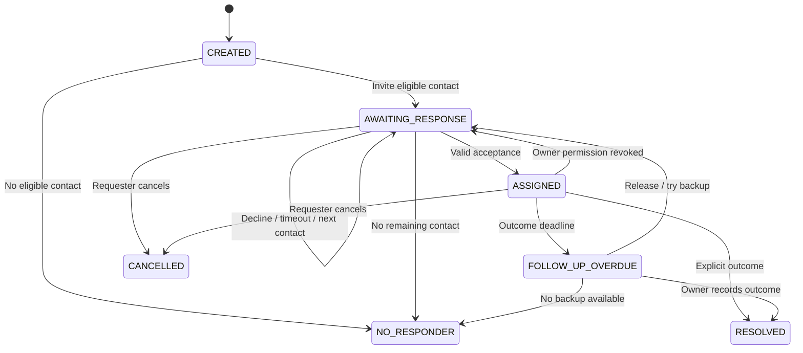

# Architecture and API

## Runtime



One Node 24 process serves the built frontend, APIs, and a one-second worker. `npm run dev` starts Vite separately and proxies `/api` to the backend. The production build is served by Express. The SQLite file and its WAL must live on persistent local storage. This is a single-instance prototype architecture, not a horizontally scaled distributed deployment.

## Trust boundaries

- Passwords use salted scrypt. Sessions use random 256-bit tokens; only SHA-256 token hashes are stored. Cookies are HTTP-only and SameSite=Strict, with configurable Secure mode for local development versus HTTPS.
- Mutations require a custom `X-Saathi-Client: web` header. CORS is not enabled, so cross-origin browsers cannot submit accepted authenticated mutations through a simple form or a successful preflight.
- The server derives identity and household from the session. Request-supplied elder IDs, role claims, and model-generated authority are not used to authorize actions.
- A centralized policy check evaluates current contact participation, request permission, drill opt-in, and allowed private fields. Reminder reads require a separate grant. Preview uses the same incident serializer as real reads.
- Arbitrary request titles, private notes, and free-text resolution outcomes are all treated as private. Restricted contacts see generic request/outcome text. Timelines contain fixed workflow descriptions, not private note content.
- Revocation blocks subsequent reads and actions and cancels pending delivery jobs. Information already received cannot be recalled.
- The AI receives the submitted text and contact names/IDs only. Its output is schema validated and does not execute actions. The user confirms through ordinary authenticated APIs. The local interpreter is explicitly labelled; it is not presented as a live model.

## Persistent state machine



SQLite `BEGIN IMMEDIATE` transactions serialize state changes and prevent two responders from claiming the same request. Attempts are bound to contact and incident, expire at an explicit timestamp, and are not reusable. The worker queries persisted due times, so a restart resumes work rather than losing a browser timer. A contact is attempted at most once per incident. When no responder remains, the incident stays visibly unresolved; starting another request is an explicit user action.

| Timer                        | Ordinary prototype request | Drill      |
| ---------------------------- | -------------------------- | ---------- |
| Response window per contact  | 2 minutes                  | 10 seconds |
| Assigned follow-up deadline  | 30 minutes                 | 60 seconds |
| Overdue grace before handoff | 5 minutes                  | 15 seconds |

These are demonstration configuration choices, not clinically established emergency thresholds. The app performs no automatic emergency dispatch.

## Weekly coverage

`coverage_preferences` and `coverage_windows` store each contact's chosen availability mode and local weekday intervals. The schema is added with `CREATE TABLE IF NOT EXISTS`, preserving existing accounts and records. Schedule rows cascade when a contact is deleted, including scoped demo resets.

`GET /api/coverage` returns the combined household plan to the older adult and only the signed-in caregiver's own plan to a caregiver. `PUT /api/coverage/me` derives the target contact from the session; a caller cannot edit another person by supplying their ID. Saves carry a schedule version and reject stale writes with 409. Windows use Monday=0 through Sunday=6, minutes from local midnight, inclusive start/exclusive end, and `1440` for end-of-day. Intervals must stay within one day; overnight commitments are entered as two windows. Overlapping and adjacent intervals are merged.

All schedules follow the older adult's household timezone. `Intl.DateTimeFormat` determines the local weekday and minute for routing, including local clock changes. Weekly duration summaries describe the typical local wall-clock week, not elapsed UTC hours on a daylight-saving transition week. The planner splits exact interval boundaries to distinguish zero, one, and multiple eligible responders; it does not approximate coverage in hourly buckets.

The current availability, participation, and request permission switches govern eligibility in both the forecast and routing. Existing contacts default to anytime availability, while a saved empty weekly plan has no coverage. Pending requests are rechecked on schedule saves and by the worker; a recipient going off schedule loses the unanswered invitation and the next currently eligible contact is considered. Acceptance is checked against current hours. Accepted ownership persists through schedule edits/end of hours, so a scheduled boundary does not abandon an active commitment. Explicit withdrawal of participation or request permission still triggers the existing handoff behavior. Read permission does not expire just because a scheduled period ends; the caregiver can finish accepted follow-up.

Gaps are advisory information in the planner. A `NO_RESPONDER` incident stays visible and is not automatically restarted when a later window opens. Drill routing uses the same scheduled hours plus drill opt-in; external messages remain disabled for drills.

## Reminders

- Fixed reminders accept one future UTC instant; the browser's manual date/time input is converted to UTC. Language clock times use the household timezone.
- Check-in reminders wait for a manual check-in. The worker schedules `received_at + offset_minutes`.
- A recurring check-in reminder is armed at most once per local day. Marking it done returns it to a waiting state for the next day. An unfinished prior occurrence is not overwritten by the next check-in.
- Duplicate event keys and reminder keys are unique per older adult. Retried confirmed creations return the existing record.
- Due reminders appear in the personal inbox. There is no guaranteed operating-system alarm when the browser is closed.

## Endpoints

All JSON mutations require `Content-Type: application/json` and `X-Saathi-Client: web`. Other than health, sign-in, registration, and the configurable demo sign-in, endpoints require a session.

| Method     | Path                               | Purpose                                                                  |
| ---------- | ---------------------------------- | ------------------------------------------------------------------------ |
| GET        | `/api/health`                      | Service and integration mode; no secrets                                 |
| POST       | `/api/auth/register`               | Register older adult, or caregiver using email-bound invite code         |
| POST       | `/api/auth/login`                  | Password sign-in                                                         |
| POST       | `/api/auth/demo`                   | Fictional demo role; disabled when demo mode is off                      |
| GET / POST | `/api/auth/me`, `/api/auth/logout` | Current account / revoke current session                                 |
| GET        | `/api/dashboard`                   | Household-scoped and field-filtered current state                        |
| GET        | `/api/coverage`                    | Household coverage for the older adult; own schedule only for caregivers |
| PUT        | `/api/coverage/me`                 | Caregiver saves own versioned weekly hours or any-time mode              |
| POST       | `/api/contacts/invite`             | Older adult generates a three-day, single-use invitation                 |
| PATCH      | `/api/contacts/:id`                | Older adult edits permission/order; caregiver edits own participation    |
| GET        | `/api/contacts/:id/preview`        | Older adult inspects allowed view; records a preview audit event         |
| POST       | `/api/interpret`                   | Return a proposal only; no state change                                  |
| POST       | `/api/check-ins`                   | Idempotent manual check-in                                               |
| POST       | `/api/reminders`                   | Save a reviewed reminder                                                 |
| PATCH      | `/api/reminders/:id`               | Complete, snooze ten minutes, or cancel                                  |
| POST       | `/api/incidents`                   | Confirm a support request                                                |
| POST       | `/api/drills`                      | Synthetic support event; no external notifications                       |
| GET        | `/api/incidents/:id`               | Current policy-filtered incident                                         |
| POST       | `/api/incidents/:id/respond`       | Accept, decline, resolve with outcome, or cancel                         |

## Optional outbound webhook

A caregiver must explicitly opt in. Only non-drill pending invitations are eligible, and policy is checked immediately before sending. The payload is deliberately generic:

```json
{
  "type": "care_request",
  "incident_id": "opaque-id",
  "recipient_id": "opaque-id",
  "message": "A care request is waiting in your Saathi inbox.",
  "url": "https://your-app.example"
}
```

The server sends an `Idempotency-Key`; the receiving provider must deduplicate. Failed sends retry at most three times. A successful HTTP response is recorded as `accepted_by_provider`, not proof of delivery. A failed external channel does not erase the already-created in-app invitation. No SMS/email provider is bundled or implicitly invoked.

## Files

`server/summary.mjs` computes the authenticated current-day summary from existing records, using the household timezone and current consent. `contacts.allow_checkins` is added through an idempotent migration with a private default; only older-adult contact updates can change it. The summary reuses request filtering and personal/household coverage scope, excludes drills, and returns minimal request list fields. `src/DailySummaryPage.tsx` refreshes the view every five seconds. Selected request details use their authenticated endpoint directly instead of relying on the dashboard's recent-item limit. See [daily summary](DAILY_SUMMARY.md).

Display-language preferences live on each user account. Existing databases receive an idempotent `users.language` migration with an English default. `PATCH /api/auth/preferences` changes only the authenticated user and validates against the shared available-language catalog. Registration accepts the same language codes; sessions and dashboard responses expose the saved choice.

The browser loads source-keyed regional dictionaries on demand, updates document language/direction, and uses bundled script fonts. User writing bypasses translation. Known generated timeline/audit copy is matched to message templates at display time; generic request titles/outcomes carry explicit system-text flags. See [localization details](LOCALIZATION.md).

`server/db.mjs` defines storage and synthetic fixtures; `auth.mjs` owns identity; `care.mjs` owns policy, actions, and deadlines; `ai.mjs` owns language interpretation. `src/App.tsx` handles session and refreshed state, `pages.tsx` contains role-specific views, and `dialogs.tsx` contains reviewed writes and incident actions.

No database, `.env`, audio recording, or provider key belongs in source control. There is no production-grade automated retention or account deletion workflow yet. The demo reset tool is scoped to the fictional household. Back up persistent storage before operating with any meaningful user data.
